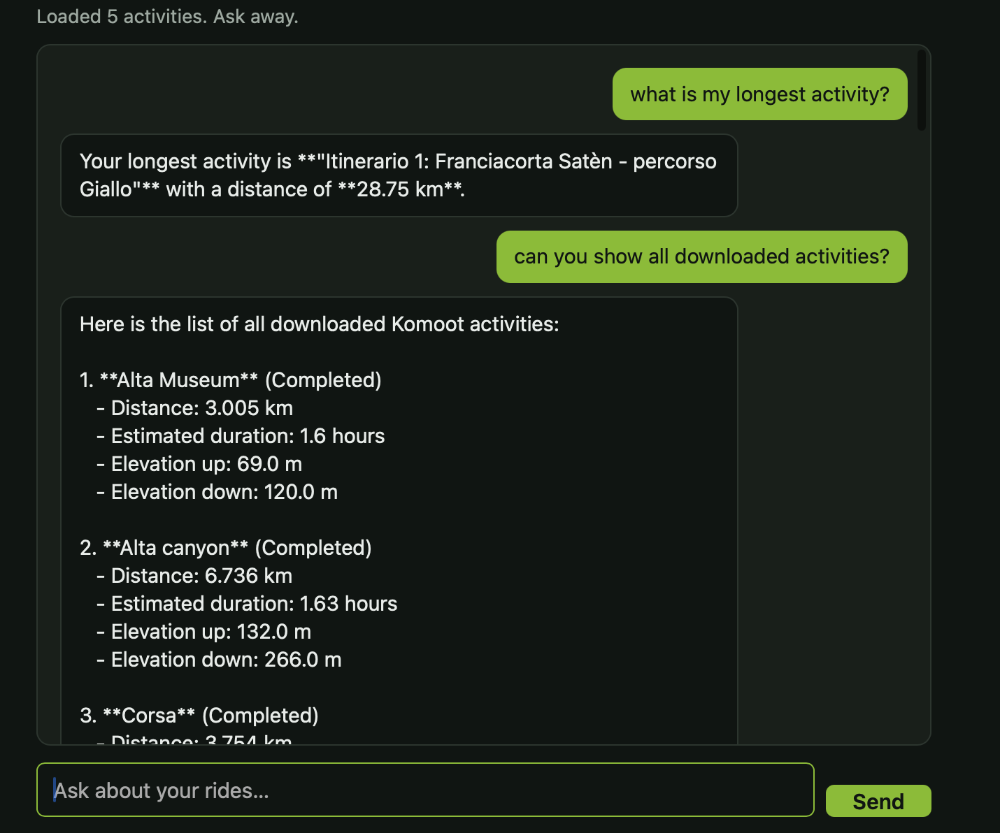

# chatgpx

Chat with your own Komoot hiking/running/cycling activities, and get real
statistics computed from the raw GPS data — not just descriptions.

You log in with your Komoot email and password, the app pulls your tours as
GPX files, and you can then chat with an LLM (over OpenRouter) that has tool
access to that data via an MCP server — including tools that compute real
distance, elevation and pace figures from the GPS track itself, not just
whatever a description string happens to say.



## How it fits together

- `server.py` — an MCP server exposing tools over your downloaded GPX
  activities (`list_activities`, `read_activity`, `get_activity_stats`,
  `get_stats_summary`, `summarize`, `generate_activity_video`) plus a
  `docs://traces` resource.
- `gpx_sync.py` — logs in to Komoot and downloads all tours as GPX files
  (`download_all_gpx(email, password, output_dir=...) -> list[Path]`),
  compatible with what `server.py` reads.
- `chat_backend.py` — connects to `server.py` over MCP stdio, exposes its
  tools to an LLM as function calls, and runs the conversation through
  OpenRouter's free tier (`chat(message: str) -> str`).
- `app.py` — the web app: serves the static frontend in `static/` and glues
  it to the two modules above via `POST /api/login` and `POST /api/chat`.
- `client.py` / `main.py` — a standalone MCP client demo, unrelated to the
  web app above.

This is a single-user demo: there's no real account system or database.
Sessions are an in-memory dict keyed by a cookie. Your Komoot password is
only held in memory for the duration of the login request and is never
logged or persisted by this app (see `gpx_sync.py`'s docstring for one
caveat inherited from the vendored `komootgpx` library itself).

## MCP tools

| Tool | What it does |
|---|---|
| `list_activities` | Name, description, file for every activity (de-duplicated by Komoot tour ID — the same tour can otherwise be exported into more than one folder and double-counted) |
| `read_activity` | Raw GPX contents of one activity |
| `get_activity_stats` | Distance, elevation gain/loss, elapsed time and pace for one activity — computed from its GPS track points, alongside Komoot's own reported numbers as a cross-check |
| `get_stats_summary` | Totals and a per-month breakdown (distance, elevation gain, activity count) across your whole history |
| `summarize` | Free-text summarization via the connected LLM |
| `generate_activity_video` | Optional: a short flyover clip via a self-hosted Cosmos3-Nano server |

`get_activity_stats` and `get_stats_summary` never trust Komoot's
description text for the numbers — they parse every trackpoint and compute
distance (haversine), elevation gain/loss, and elapsed time directly, so the
figures hold up even if a file's metadata is missing or stale. Where Komoot
does report its own numbers, they're returned side by side for comparison
(in practice they mostly agree closely; elevation loss tends to diverge a
bit more, most likely due to GPS altitude noise vs. Komoot's own smoothing).

## Prerequisite: the `KomootGPX` submodule

`gpx_sync.py` imports `komootgpx.api.KomootApi` from the
[KomootGPX](https://github.com/timschneeb/KomootGPX) library, vendored as a
git submodule at `./KomootGPX/`. A plain `git clone` of this repo leaves
that directory empty - fetch it with:

```bash
git submodule update --init
```

Downloaded activity GPX files go in `./activities/` instead - a separate,
gitignored, plain data directory. It's named nothing like "komootgpx" on
purpose: this repo lives on a case-insensitive filesystem (default macOS),
where "activities" can't accidentally collide with "KomootGPX" the way two
names differing only in case would. `docker compose up --build` picks up
the submodule too, since Docker only respects `.dockerignore`, not
`.gitignore`, and the checked-out submodule files are on disk either way.

## Configuration

Copy `.env.example` to `.env` and fill in `OPENAI_API_KEY` / `OPENAI_BASE_URL`
/ `OPENAI_MODEL` - one OpenAI-compatible provider and key shared by both
`client.py` and the web app's chat (Mistral, OpenRouter, OpenAI itself,
anything else that speaks the same API and supports tool calling). See
`.env.example` for the rest, all optional.

## Run with Docker (recommended)

```bash
cp .env.example .env   # then edit it
docker compose up --build
```

Open http://localhost:8000.

## Run without Docker

Requires [uv](https://docs.astral.sh/uv/) and Python 3.10+.

```bash
cp .env.example .env   # then edit it
uv sync
uv run uvicorn app:app --host 0.0.0.0 --port 8000
```

Open http://localhost:8000.

Or skip the web app entirely and talk to `server.py` from any MCP client —
`client.py` is a small standalone example (`uv run client.py`).

The login form has a collapsible "Sync options" section wrapping a few of
[KomootGPX](https://github.com/timschneeb/KomootGPX)'s many CLI flags: tour
type (all/planned/recorded), a sport filter (matched exactly against
Komoot's own sport id, e.g. `hike`, `running`), and a date range. All are
optional and applied client-side against the fetched tour list, the same
way komootgpx's own CLI does it - useful for re-syncing just a recent
window instead of your whole history every time.

## Using the MCP server from other tools

By default `server.py` runs over stdio and is only reachable by being
spawned as a subprocess (that's what `client.py` and `chat_backend.py` do).
To expose it to an external MCP client/tool over the network instead, run
it with the `streamable-http` transport:

```bash
uv run server.py --transport streamable-http --host 127.0.0.1 --port 8765
```

Any MCP client that speaks the streamable-http transport can then connect
to `http://127.0.0.1:8765/mcp` and use `list_activities`,
`get_activity_stats`, `get_stats_summary`, etc. directly - no need to spawn
this repo as a subprocess. `--host 0.0.0.0` makes it reachable from outside
localhost (e.g. from inside a Docker network or another machine); there's
no authentication in front of it, so only do that on a network you trust.

## Development notes

- `app.py` imports `gpx_sync` and `chat_backend` defensively: if either
  module isn't importable yet, the corresponding endpoint (`/api/login` or
  `/api/chat`) returns `503` instead of crashing the app, and a warning is
  logged at startup.
- `server.py` is spawned as a subprocess (over MCP stdio) by `chat_backend.py`
  the first time `/api/chat` is used (or eagerly at app startup); you don't
  run it separately.
